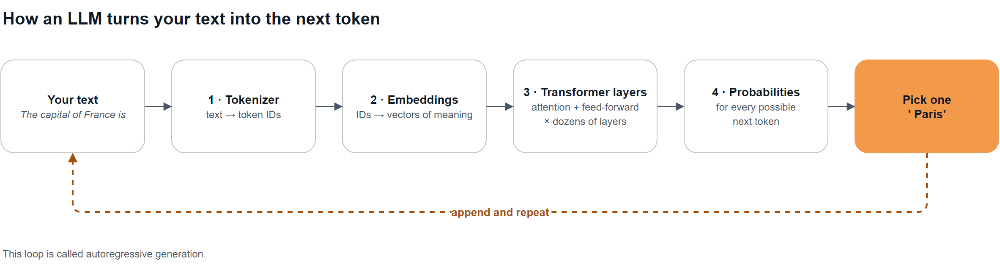
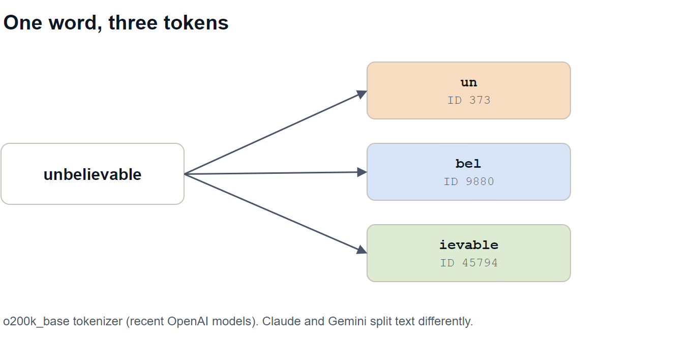
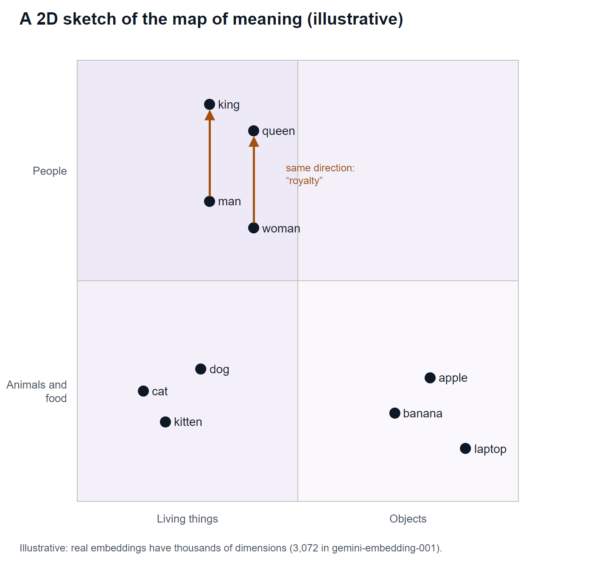
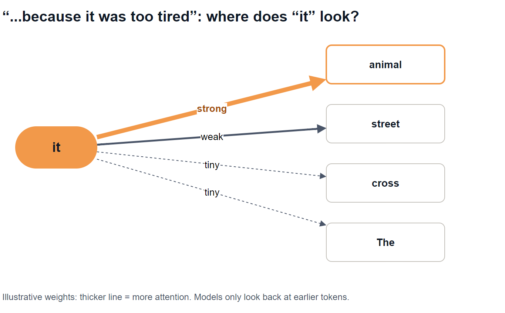
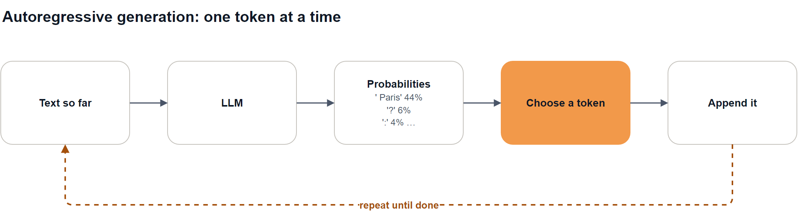
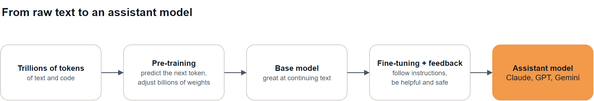

# Episode 03: How LLMs Actually Work, Intuitively

Tokens, embeddings, attention and next-token prediction, without the heavy maths.

> **Module 1: LLM Foundations** · Episode 3 of 42 · [Slides](https://amitpnk.github.io/genai-zero-to-production/ep03-how-llms-work/)

## What you'll learn

- Why an LLM really does just **one thing**: predict the next token
- How text becomes **tokens**, and why that affects cost and quirks
- How tokens become **embeddings**: numbers that capture meaning
- What **attention** does, in plain English
- Why LLMs **hallucinate**, and what that means for you as an engineer

---

## 1. The big idea

> **An LLM is a next-token predictor.** Give it some text, and it returns a probability for every possible next token. Pick one, add it to the text, and repeat.

Every chat reply, every summary and every line of code you've seen an LLM write came out **one token at a time** through that loop.

## 2. The whole picture



We'll walk through each box in order.

> Diagram sources: [`diagrams.drawio`](diagrams.drawio), one page per diagram. Open it in draw.io to edit.

---

## 3. Step 1: Tokens

Models don't read letters or words. They read **tokens**: common chunks of text, each with a number (its ID).

Real output from [`tokens.py`](tokens.py), which uses the `o200k_base` tokenizer from recent OpenAI models:

| Text | Tokens | Pieces |
| --- | --- | --- |
| `Hello world` | 2 | `Hello` · ` world` |
| `unbelievable` | 3 | `un` · `bel` · `ievable` |
| `GenAI engineering is fun!` | 6 | `Gen` · `AI` · ` engineering` · ` is` · ` fun` · `!` |
| `ChatGPT, Claude and Gemini` | 6 | `Chat` · `GPT` · `,` · ` Claude` · ` and` · ` Gemini` |
| `नमस्ते दुनिया` ("Hello world" in Hindi) | 5 | `न` · `म` · `स्त` · `े` · ` दुनिया` |



**Things to notice:**

- Common words are **one token**. Rare words split into pieces.
- The **space is part of the token** (` world`, not `world`).
- The same phrase in Hindi uses **more tokens** than in English, so it costs more and fills the context faster.
- **Every model family has its own tokenizer**, so Claude, GPT and Gemini count the same text differently.

**Rule of thumb for English:** 1 token ≈ 4 characters ≈ ¾ of a word. 1,000 tokens ≈ 750 words.

**Why it matters to you:**

| Because the model sees tokens... | You get |
| --- | --- |
| You're billed per token, in and out | Cost depends on tokens, not words |
| Context windows are measured in tokens | Long documents may not fit (Episode 4) |
| It never sees individual letters | It can struggle to count the r's in "strawberry" |

## 4. Step 2: Embeddings

A token ID like `373` means nothing by itself. So each token is turned into an **embedding**: a long list of numbers (thousands of them) that places it on a giant **map of meaning**.

- Words with **similar meanings** land **close together**.
- **Directions** on the map carry meaning too.



Real output from [`embeddings.py`](embeddings.py), using `gemini-embedding-001` (3,072 numbers per word):

```text
Most similar to 'cat':
  dog      0.747  ###############
  kitten   0.730  ##############
  man      0.661  ##########
  ...
  king     0.629  ########

king - man + woman  ~  queen
```

> Read the scores **relative to each other**, not as percentages. What matters is that "dog" and "kitten" rank above "laptop" and "banana".

**king − man + woman ≈ queen** is the classic example: take the direction from "man" to "king" (roughly *royalty*), add it to "woman", and you land near "queen".

The model also adds **position** information, so it knows the order: "dog bites man" ≠ "man bites dog".

> You'll use embeddings directly for search and RAG in **Module 3**.

## 5. Step 3: Attention

There's a problem: the word **"bank"** gets the same starting embedding in *"river bank"* and *"bank account"*. Meaning depends on **context**.

**Attention** fixes this. Each token **looks at the other tokens before it** and decides how much each one matters to its own meaning. Then it updates itself.

Example: *"The animal didn't cross the street because **it** was too tired."* What does **"it"** refer to?



*Illustrative weights.* "it" pays most attention to "animal", so its meaning shifts towards *the animal*. In *"...because it was too **wide**"*, the later words look back the same way and link "it" to "street" instead.

> Models like GPT, Claude and Gemini only look **backwards**: each token attends to the tokens before it, never ahead. That's what makes one-token-at-a-time generation possible.

**A useful mental model:** every token asks three things:

| | Plain English |
| --- | --- |
| **Query** | "What am I looking for?" |
| **Key** | "What do I contain?" |
| **Value** | "What do I pass on if you pick me?" |

A token's query is compared with every other token's key. Good matches get more attention, and their values are mixed in.

**Then the model stacks it.** A **transformer** repeats *attention → a small feed-forward network* in **dozens of layers**. Early layers pick up grammar; later layers build up facts, intent and reasoning. Many attention "heads" run in parallel, each looking for different patterns.

> In one line: **attention lets every word look at the other words and update its meaning in context.**

## 6. Step 4: Predicting the next token

After the last layer, the model turns the final position into a **probability for every token in its vocabulary**, typically 100,000 to 250,000 options.

Real output from [`next_token.py`](next_token.py), running `gemma3:1b` locally with Ollama:

```text
Prompt: 'The capital of France is'

Step 1: the model's top guesses
   ' Paris'        44.1%  ##################  <- picked
   '?'              6.2%  ##
   ':'              4.2%  ##
   ...
   text so far: 'The capital of France is Paris'

Step 2: the model's top guesses
   '.'             64.4%  ##########################  <- picked
   '?'             13.2%  #####
   ...
```



**This loop is called autoregressive generation.** It explains a lot:

- **Streaming:** replies appear word by word because they're *made* word by word.
- **Output costs more than input:** each output token needs its own pass through the model.
- **Different answers each time:** if the model *samples* instead of always picking the top token, you get variety. You'll control this with **temperature** in Episode 5.

## 7. Where does the knowledge come from?



- **Pre-training:** the model sees huge amounts of text, guesses the next token, and nudges its **weights** (billions of numbers) every time it's wrong. Knowledge ends up stored in those weights.
- **Instruction tuning and human feedback** turn a text-continuer into an assistant that answers questions.

**This is why LLMs hallucinate.** The model produces the most *plausible* next token, not a fact looked up from a database. When it doesn't really know, plausible and true can differ. This is why **grounding with your own data (RAG)** and **evaluation** matter so much in this series.

## 8. What this means for you as an engineer

| What the model does | So you should |
| --- | --- |
| Reads tokens, not words | Estimate cost and limits in tokens |
| Only sees what's in the context | Put the right information in the prompt (Modules 2 and 4) |
| Predicts plausible text | Ground answers in data and evaluate them (Modules 4 and 9) |
| Generates one token at a time | Stream long replies; keep outputs short when you can |
| Can sample differently each run | Control temperature, and test more than once |

---

## Run the demos

From the repo root:

```bash
uv sync                                           # installs tiktoken
uv run python ep03-how-llms-work/tokens.py        # no API key needed
uv run python ep03-how-llms-work/embeddings.py    # Gemini API key (free tier works)
uv run python ep03-how-llms-work/next_token.py    # local model with Ollama
```

**Setup for the demos:**

1. Add these two lines to your `.env` (they're in `.env.example`):
   ```ini
   GEMINI_EMBEDDING_MODEL=gemini-embedding-001
   OLLAMA_MODEL=gemma3:1b
   ```
2. For `next_token.py`, install [Ollama](https://ollama.com/download), then download the small model (about 800 MB):
   ```bash
   ollama pull gemma3:1b
   ```

New to Ollama? See the [Ollama cheat sheet](../guides/ollama/) for every command: running, listing and stopping models.

| Error | Fix |
| --- | --- |
| `KeyError: 'GEMINI_EMBEDDING_MODEL'` or `'OLLAMA_MODEL'` | Add the line to `.env` (step 1) |
| `ConnectionRefusedError` / `URLError` | Ollama isn't running: open the Ollama app, or run `ollama serve` |
| `model 'gemma3:1b' not found` | Run `ollama pull gemma3:1b` |
| `ModuleNotFoundError: tiktoken` | Run `uv sync` |

> Your numbers may differ slightly from the ones above. Model versions change, and that's fine: the patterns stay the same.

---

## Interview question (FDE)

> **"Explain attention to a non-technical customer in 60 seconds."**

**A strong answer:**

> "When you read *'the bank was flooded after the storm'*, you know 'bank' means a river bank because of the words around it. Attention gives a model that same skill. For every word, it looks back at the other words and decides which ones matter most for understanding it, then updates its meaning. It does that for every word, across many layers, which is how it keeps track of who 'it' refers to or what a question is really asking. That's why these models handle context so well, and also why what you put in the prompt matters so much."

Practise it: say it out loud in your own words before moving on.

## Recap

- An LLM **predicts the next token**, then repeats. That's the whole loop.
- **Tokens** are chunks of text. They drive cost, limits and some odd quirks.
- **Embeddings** turn tokens into numbers on a map of meaning.
- **Attention** lets each token use its context to update its meaning, layer after layer.
- Models produce **plausible** text, not looked-up facts, so ground and evaluate them.

## Next up

**Episode 04: Tokenization and context windows.** Why token counts drive cost, latency and truncation, and how to measure them for Claude, GPT and Gemini.
