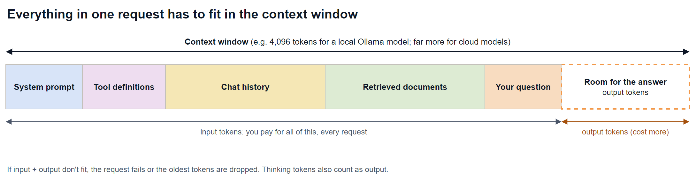
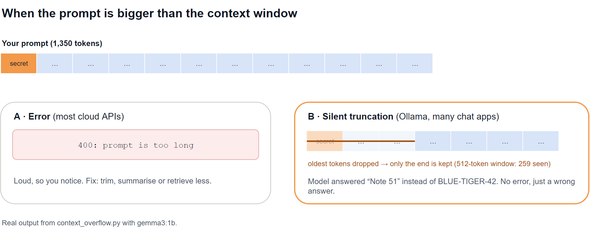
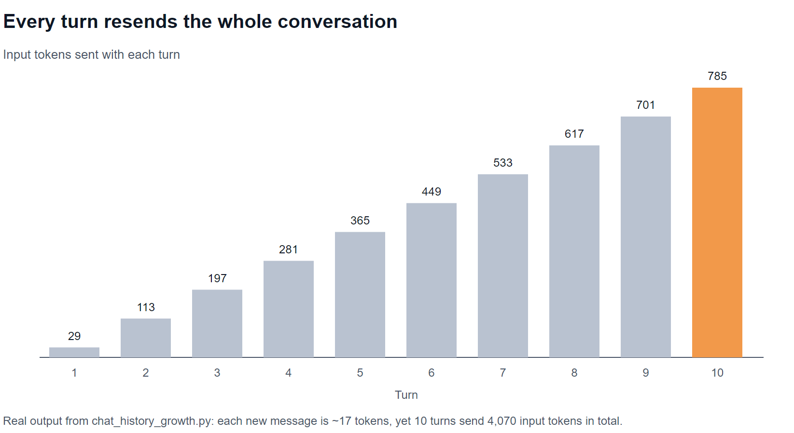
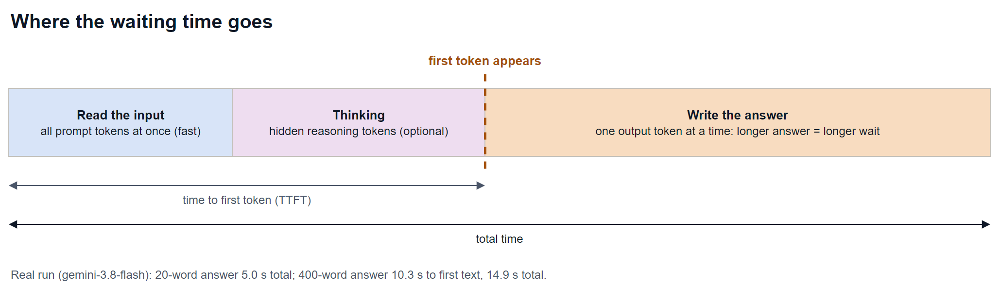

# Episode 04: Tokenization and Context Windows

Why token counts drive cost, latency and truncation, and how to measure them.

> **Module 1: LLM Foundations** · Episode 4 of 42 · [Slides](https://amitpnk.github.io/genai-zero-to-production/ep04-tokens-and-context-windows/)

## What you'll learn

- How to **count tokens**, and why Claude, GPT and Gemini count differently
- What a **context window** is, and everything that has to fit inside it
- What happens when a prompt **doesn't fit** (spoiler: sometimes nothing tells you)
- Why **long chats get expensive**, and where the **waiting time** goes
- Practical ways to keep prompts **small, fast and cheap**

---

## 1. The big idea

> **Everything is measured in tokens:** what you pay, how long you wait, and how much the model can see.

In [Episode 3](../ep03-how-llms-work/) you saw that models read tokens, not words. This episode turns that into engineering: counting them, budgeting them and keeping them under control.

## 2. Counting tokens

**Every model family has its own tokenizer**, so the same text gives different counts. Real output from [`count_tokens.py`](count_tokens.py):

| Text | Characters | OpenAI (`o200k_base`) | Gemini |
| --- | ---: | ---: | ---: |
| English sentence | 87 | 18 | 19 |
| Hindi sentence | 98 | 37 | 30 |
| Python code | 66 | 27 | 31 |
| JSON | 77 | 29 | 34 |
| Numbers | 45 | 25 | **46** |

**What to notice:**

- **English** is the most efficient: about 4 characters per token.
- **Other languages, code, JSON and numbers** need more tokens per character.
- Gemini splits **numbers digit by digit**, so 45 characters of numbers became 46 tokens.
- The gap between tokenizers can be big, so **always count with the tokenizer of the model you're using**.

**How to count for each provider:**

| Provider | How |
| --- | --- |
| OpenAI | `tiktoken` locally (free, offline) |
| Gemini | `client.models.count_tokens(...)` (free API call) |
| Claude | `client.messages.count_tokens(...)` (free API call) |
| After any call | Read the **usage** numbers in the response: they're exact and they're what you're billed for |

## 3. The context window

The **context window** is the maximum number of tokens a model can handle in **one request: input and output together**.



People forget that **all of this** shares the same window:

- the **system prompt** and **tool definitions**, sent on every request
- the whole **chat history**
- any **documents** you paste in or retrieve
- **your question**
- and **room for the answer**: if the input fills the window, there's no space left to reply

**How big is it?** It depends on the model:

| Model | Context window |
| --- | --- |
| `gemma3:1b` (local, Ollama) | supports 32,768 tokens, but Ollama **defaults to 4,096** to save memory |
| Cloud models (Claude, GPT, Gemini) | from around a hundred thousand to over a million tokens; check each model's docs |

There's usually a **separate output limit** too (`max_tokens` / `max_output_tokens`), which is much smaller than the context window.

> **Bigger isn't free.** A bigger window lets you send more, but you pay for every input token, every time, and responses get slower.

## 4. When the prompt doesn't fit



Real output from [`context_overflow.py`](context_overflow.py). A secret code sits at the very start of a 1,350-token prompt:

```text
Context window  4096 tokens -> model saw  1350 prompt tokens -> reply: 'BLUE-TIGER-42'
Context window   512 tokens -> model saw   259 prompt tokens -> reply: 'Note 51'
```

With the small window, Ollama kept only the **last** 259 tokens. The secret was gone, and the model **confidently gave a wrong answer** with no error at all.

| Behaviour | Where | Risk |
| --- | --- | --- |
| **Error** (e.g. "prompt is too long") | Most cloud APIs | Loud, so you notice and fix it |
| **Silent truncation** (oldest tokens dropped) | Ollama, many chat apps and frameworks | Quiet wrong answers: the dangerous one |

**This is also why chatbots "forget"** the start of a long conversation: the oldest messages get trimmed to fit.

### Even when it fits: lost in the middle

Research ("Lost in the Middle", Liu et al., 2023) found models use information at the **start and end** of a long prompt more reliably than information buried in the **middle**. Put the most important instructions and facts near the start or the end.

## 5. Why long chats get expensive

The model has no memory between requests. **To continue a chat, your app resends the whole conversation every turn.**



Real output from [`chat_history_growth.py`](chat_history_growth.py):

```text
Turn  input tokens sent  running total
   1                 29             29
   2                113            142
  ...
  10                785          4,070

10 turns sent 4,070 input tokens, though each new message is only ~17.
```

Each new message was tiny, but the **total keeps climbing**, and it grows faster the longer the chat runs. Multiply that by every user, every day.

## 6. Cost: input vs output

You're billed separately for **input** and **output** tokens, and **output usually costs several times more** than input.

```text
cost = input_tokens  × input_price
     + output_tokens × output_price      (prices are per million tokens)
```

**Watch out for thinking tokens.** Reasoning models think before answering, and that hidden reasoning is **billed as output**. Real output from [`cost_and_latency.py`](cost_and_latency.py) with `gemini-3.8-flash`:

| Request | Input | Output | Thinking (hidden) |
| --- | ---: | ---: | ---: |
| "Describe the ocean in about 20 words." | 11 | 24 | **547** |
| "Describe the ocean in about 400 words." | 12 | 464 | **850** |

The 20-word answer used **over 20× more thinking tokens than visible output**. Always check the usage numbers in the response, not just the text.

> The demo uses **example prices** to show the maths. Prices change often, so always check your provider's pricing page.

## 7. Latency: where the waiting time goes



| Measure | Driven by | Real run |
| --- | --- | --- |
| **Time to first token (TTFT)** | input size, plus any thinking | 5.0 s (short answer) |
| **Total time** | mostly **output length** | 5.0 s for ~20 words vs **14.9 s** for ~400 words |

Reading the input is fast because all input tokens are processed together. Writing is slow because **output is generated one token at a time** (Episode 3's loop). **Streaming** shows the first words early, so the wait *feels* shorter.

## 8. How to keep prompts small, fast and cheap

| Problem | Fix |
| --- | --- |
| Long chat history | Keep the last few turns; **summarise** older ones |
| Pasting whole documents | **Retrieve only the relevant chunks** (RAG, Module 4) |
| Long, rambling answers | Ask for brevity; set **`max_tokens`** |
| Same big prompt every time | **Prompt caching** makes repeated input cheaper (Module 10) |
| Hard task on a big model | Use a **smaller model** for simple steps (Module 10) |
| Important facts get missed | Put them at the **start or end** of the prompt |
| Not sure what you spent | Log **usage** from every response |

---

## Run the demos

From the repo root:

```bash
uv run python ep04-tokens-and-context-windows/count_tokens.py         # Gemini key; Claude too if you've set one
uv run python ep04-tokens-and-context-windows/chat_history_growth.py  # no key needed
uv run python ep04-tokens-and-context-windows/context_overflow.py     # local Ollama
uv run python ep04-tokens-and-context-windows/cost_and_latency.py     # Gemini key
```

These use the same `.env` settings as Episode 3 (`GEMINI_MODEL`, `OLLAMA_MODEL`). `count_tokens.py` adds a **Claude** column automatically if `ANTHROPIC_API_KEY` and `ANTHROPIC_MODEL` are set. For Ollama commands, see the [Ollama cheat sheet](../guides/ollama/).

> Your numbers will differ a little: models and tokenizers change. The patterns stay the same.

---

## Interview question (FDE)

> **"A customer says their support chatbot gets slower and more expensive the longer a conversation runs, and sometimes forgets what the user said at the start. What's going on, and what do you do?"**

**A strong answer:**

> "The model has no memory, so the app resends the whole conversation every turn. Input tokens grow with every message, which drives up both cost and latency. Once the history outgrows the context window, the oldest messages get trimmed, which is why it forgets the start. I'd first measure it by logging token usage per turn. Then I'd keep only the recent turns and a running summary of older ones, retrieve only the relevant knowledge instead of pasting everything in, cap the output length, and use prompt caching for the fixed system prompt."

Practise it: say it out loud in your own words before moving on.

## Recap

- **Tokens are the unit** of cost, speed and capacity. Count them with the right tokenizer.
- The **context window** holds input *and* output: system prompt, tools, history, documents, question and answer.
- Overflowing it either **errors** or **silently drops the oldest tokens**.
- Chats **resend everything**, so input tokens snowball.
- **Output tokens** (including hidden thinking) cost more and take longer.

## Next up

**Episode 05: Sampling parameters.** Temperature, top-p, max tokens and stop sequences, with live side-by-side outputs.

---

<sub>Diagram sources: [`diagrams.drawio`](diagrams.drawio), one page per diagram. Open it in draw.io to edit.</sub>
