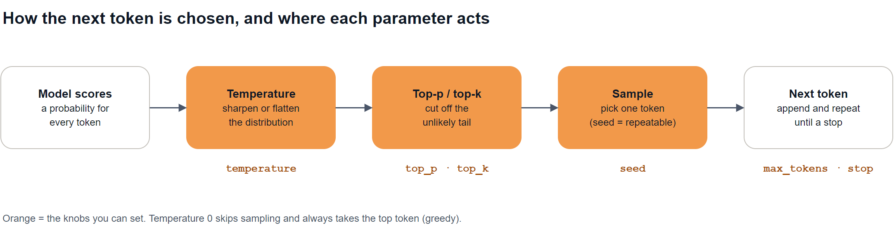
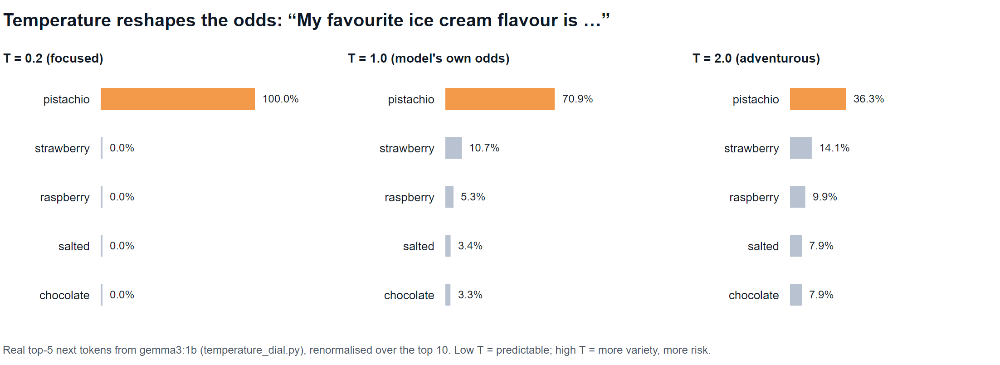
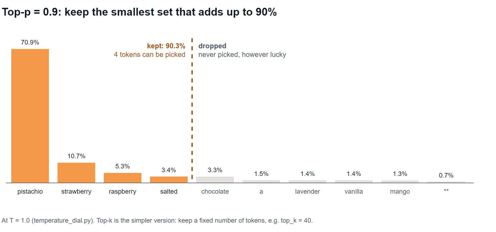
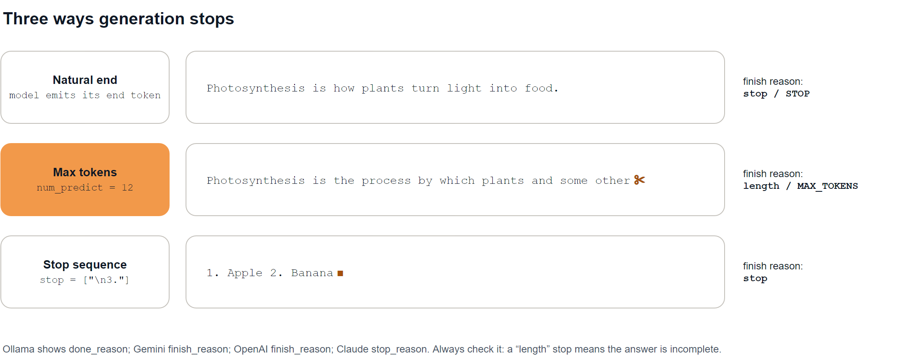

# Episode 05: Sampling Parameters

Temperature, top-p, max tokens, stop sequences and seeds, with live side-by-side outputs.

> **Module 1: LLM Foundations** · Episode 5 of 42 · [Slides](https://amitpnk.github.io/genai-zero-to-production/ep05-sampling-parameters/)

## What you'll learn

- What **temperature** really does to the model's choices, and what value to use when
- How **top-p** and **top-k** cut off unlikely tokens
- How **max tokens** and **stop sequences** end an answer, and how to tell which one did
- Why **temperature 0 isn't a determinism guarantee**, and what a **seed** does
- A gotcha with **reasoning models**: hidden thinking eats your output budget

---

## 1. The big idea

> **The model gives you odds. Sampling parameters decide how you pick from those odds, and when to stop.**

In [Episode 3](../ep03-how-llms-work/) the model scored every possible next token. Sampling parameters sit between those scores and the token that actually gets picked.



## 2. Temperature

**Temperature reshapes the odds** before a token is picked:

- **Low (0–0.3):** the top token wins almost every time, giving focused and repeatable output
- **1.0:** the model's own odds
- **High (above 1):** the odds flatten and unlikely tokens get a real chance, giving more variety and more risk

Real output from [`temperature_dial.py`](temperature_dial.py), using `gemma3:1b`'s actual next-token odds:



**Side by side**, real output from [`side_by_side.py`](side_by_side.py) for *"Write a one-sentence slogan for a coffee shop"*:

| Temperature | Run 1 | Run 2 | Run 3 |
| --- | --- | --- | --- |
| **0** | Fuel your day, one cup at a time. | Fuel your day, one cup at a time. | Fuel your day, one cup at a time. |
| **0.8** | Your daily dose of happiness. | Your daily dose of comfort and connection. | Fuel your day, savor the moment. |
| **1.8** | Fuel your day, one delicious cup at a time. | A daily dose of comfort. | Brewed with love and served with joy. |

> Temperature 0 is often called **greedy decoding**: always take the top token, no randomness.

**What to use when:**

| Task | Temperature |
| --- | --- |
| Extraction, classification, code, maths | **0 – 0.3** |
| Q&A, summaries, chat | **0.3 – 0.8**, or the provider default |
| Brainstorming, creative writing | **0.8 – 1.2** |
| Production systems | rarely above ~1.2: quality drops fast |

**Start with the provider's default.** Change it only when you have a reason, and test the result.

## 3. Top-p and top-k

Even at a normal temperature there's a long tail of unlikely tokens. Very occasionally one gets picked and the answer goes off the rails. **Top-p and top-k cut the tail off.**

- **Top-p (nucleus sampling):** keep the smallest set of tokens whose probabilities add up to **p**, and drop the rest
- **Top-k:** keep only the **k** most likely tokens



> **Change temperature *or* top-p, not both.** They overlap, providers generally advise adjusting one, and some APIs reject requests that set both.

## 4. Max tokens: the hard ceiling

**Max tokens caps how long the answer can be.** It protects your bill and your latency, but if it's too low the answer is **cut mid-sentence**.

Real output from [`max_tokens_and_stop.py`](max_tokens_and_stop.py):

```text
1) max tokens = 12
   output: 'Photosynthesis is the process by which plants and some other'
   stopped because: 'length' after 12 tokens  <- cut mid-sentence
```

**Always check the finish reason.** A `length` stop means the answer is **incomplete**:



### Gotcha: thinking eats the budget

With reasoning models, **hidden thinking counts towards the limit**. Real output from [`gemini_gotchas.py`](gemini_gotchas.py) with `gemini-3.8-flash`:

```text
limit   50: thinking   44 + answer   2 -> MAX_TOKENS 'Brew'
limit  300: thinking  289 + answer   7 -> MAX_TOKENS 'Where every cup feels like coming home'
limit 2000: thinking  652 + answer   8 -> STOP       'Where every cup feels like coming home.'
```

A 300-token limit sounds generous for a one-line slogan, but the model spent 289 tokens thinking and was cut off before finishing. **Leave plenty of headroom with reasoning models.**

## 5. Stop sequences

A **stop sequence** is text that ends generation the moment it appears. It's useful for keeping output to one item, one line or one section.

```text
2) stop sequence = "\n3."
   output: ' Apple\n2. Banana'
   stopped because: 'stop'  <- the stop text itself is not included
```

Common uses: stop at `"\n\n"` for one paragraph, at `"</answer>"` for tagged output, or at the next `"User:"` in a transcript.

## 6. Seeds and determinism

- A **seed** makes the random choices repeatable. With Ollama, temperature 1.0 and `seed=42` gave **the same slogan twice**.
- **Temperature 0 isn't a guarantee on cloud APIs.** Real output with Gemini at temperature 0, same prompt, three runs:

```text
run 1: Where every cup feels like coming home.
run 2: Where every great day begins with the perfect cup.
run 3: Crafted with passion, brewed with care, and poured to brighten your day.
```

Cloud models run across many servers, batch requests together and use tiny floating-point shortcuts, and reasoning models think before answering. Small differences add up. **Design for variation:** validate outputs and retry instead of assuming identical answers.

> **Reasoning models may restrict these knobs.** Some don't accept temperature at all, or require the default while thinking is on. Check your model's docs.

## 7. The same knobs across providers

| Knob | OpenAI | Claude | Gemini | Ollama |
| --- | --- | --- | --- | --- |
| Temperature | `temperature` | `temperature` | `temperature` | `temperature` |
| Top-p | `top_p` | `top_p` | `top_p` | `top_p` |
| Top-k | — | `top_k` | `top_k` | `top_k` |
| Max tokens | `max_output_tokens` (Responses) / `max_completion_tokens` (Chat) | `max_tokens` (**required**) | `max_output_tokens` | `num_predict` |
| Stop sequences | `stop` (Chat Completions) | `stop_sequences` | `stop_sequences` | `stop` |
| Seed | `seed` (Chat Completions) | — | `seed` | `seed` |
| Finish reason | `finish_reason` / `status` | `stop_reason` | `finish_reason` | `done_reason` |

*Names and support change between API versions, so check the current docs for your model.*

---

## Run the demos

From the repo root:

```bash
uv run python ep05-sampling-parameters/temperature_dial.py      # local Ollama
uv run python ep05-sampling-parameters/side_by_side.py          # local Ollama
uv run python ep05-sampling-parameters/max_tokens_and_stop.py   # local Ollama
uv run python ep05-sampling-parameters/gemini_gotchas.py        # Gemini key
```

These use the same `.env` settings as Episodes 3–4 (`OLLAMA_MODEL`, `GEMINI_MODEL`). For Ollama help, see the [Ollama cheat sheet](../guides/ollama/).

> Sampling is random by design, so your outputs **will** differ from these. That's the point of the episode.

---

## Interview question (FDE)

> **"A customer's extraction pipeline returns slightly different JSON on every run, and sometimes the JSON is cut off halfway. What do you check?"**

**A strong answer:**

> "Two separate problems. Cut-off JSON is almost always the output limit: I'd check the finish reason. If it says `length` or `max_tokens`, raise the limit, and with reasoning models remember that thinking tokens count too. For the variation, I'd lower temperature to near zero and leave top-p alone. But even at zero, cloud models aren't fully deterministic, so I wouldn't rely on that. I'd use structured outputs with a schema, validate every response, and retry on failure. If they need repeatability for testing, I'd use a seed where the API supports one."

Practise it: say it out loud in your own words before moving on.

## Recap

- **Temperature** reshapes the odds: low is focused, high is varied. Start with the default.
- **Top-p / top-k** cut off the unlikely tail. Tune temperature *or* top-p, not both.
- **Max tokens** is a hard ceiling. Check the **finish reason**, and leave room for thinking.
- **Stop sequences** end output cleanly at text you choose.
- **Seeds** help repeatability, but **temperature 0 isn't a guarantee**: validate and retry.

## Next up

**Episode 06: The model landscape.** Closed vs open-weight models, model families, and how to choose the right one for a use case.

---

<sub>Diagram sources: [`diagrams.drawio`](diagrams.drawio), one page per diagram. Open it in draw.io to edit.</sub>
