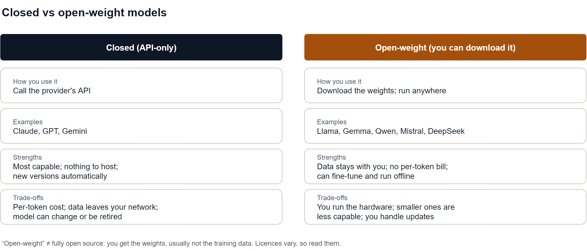
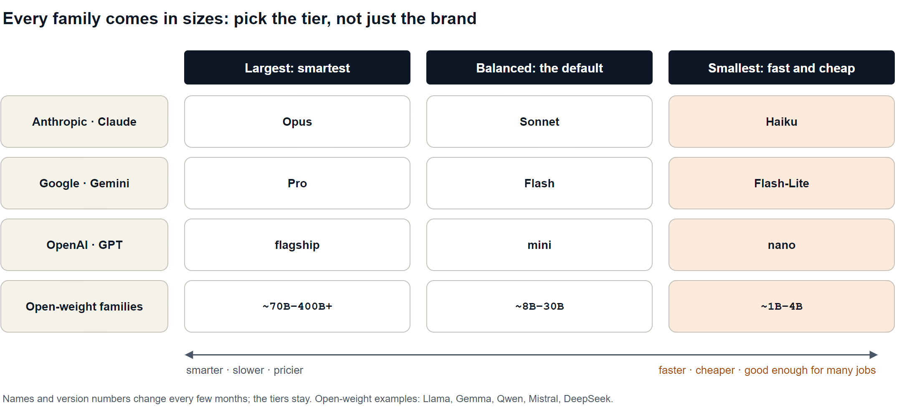
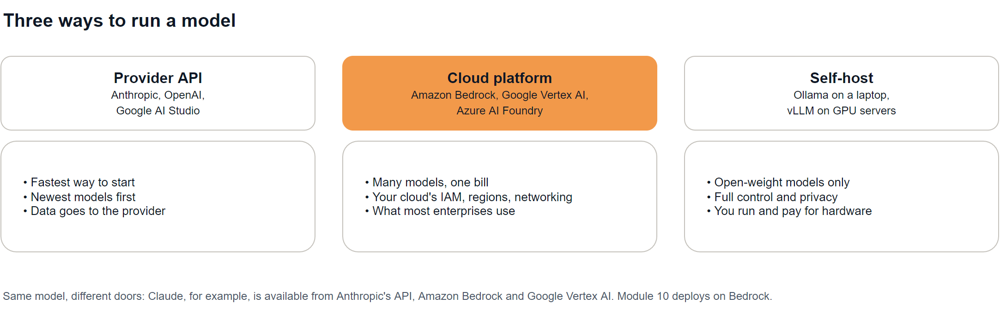

# Episode 06: The Model Landscape

Closed vs open-weight models, model families and tiers, where models run, and how to choose one for a use case.

> **Module 1: LLM Foundations** · Episode 6 of 42 · [Slides](https://amitpnk.github.io/genai-zero-to-production/ep06-model-landscape/)

## What you'll learn

- The difference between **closed** and **open-weight** models, and when each makes sense
- How model **families and tiers** work, so new model names don't confuse you
- The three places a model can **run**: provider API, cloud platform, or self-hosted
- A simple, repeatable way to **choose a model** for a job, backed by your own tests

---

## 1. The big idea

> **There's no single best model.** Pick the **smallest, cheapest model that passes your tests** for the job, within your constraints.

Model names and leaderboards change every few months. The *way you choose* doesn't. This episode gives you a map that still works when today's model names are gone.

## 2. Closed vs open-weight



| | Closed (API-only) | Open-weight |
| --- | --- | --- |
| **How you use it** | Call the provider's API | Download the weights, run anywhere |
| **Examples** | Claude, GPT, Gemini | Llama, Gemma, Qwen, Mistral, DeepSeek |
| **Best for** | Top capability, no hosting, fast start | Privacy, offline use, fine-tuning, cost at scale |
| **Watch out for** | Per-token cost; data leaves your network; models get retired | You run the hardware; small ones are less capable |

> **"Open-weight" isn't the same as "open source".** You get the trained weights, but usually not the training data or code. **Licences vary**: some restrict commercial use or very large companies. Read the licence before you ship.

You've already used both: **Gemini** (closed) since Episode 2, and **`gemma3:1b`** (open-weight, via Ollama) since Episode 3.

## 3. Families and tiers

Every major family comes in **sizes**. The tier usually matters more than the brand:



| Tier | Good at | Trade-off |
| --- | --- | --- |
| **Largest** (e.g. Claude Opus, Gemini Pro) | Hard reasoning, long complex tasks, coding agents | Slowest and most expensive |
| **Balanced** (e.g. Claude Sonnet, Gemini Flash) | The sensible default for most apps | Middle on everything |
| **Smallest** (e.g. Claude Haiku, Gemini Flash-Lite) | Classification, extraction, routing, high volume | Weaker on multi-step reasoning |

**Other things that set models apart:**

- **Reasoning / thinking modes:** spend extra (hidden) tokens to think before answering (Episodes 4–5)
- **Modalities:** text only, or images, audio and video too (Module 6)
- **Specialist models:** embeddings (Episode 3, Module 3), image generation, speech
- **Context window:** from a few thousand tokens locally to over a million in the cloud (Episode 4)

> Version numbers move fast. When you see a new model name, ask: **which family, which tier, closed or open?** That tells you most of what you need.

## 4. Discover what's available right now

Don't trust a list in a blog post (or in these notes!). **Ask the API.** Real output from [`list_models.py`](list_models.py):

```text
Cloud: Gemini models your key can call (listing is free)

   model                         context (in)   max out
   gemini-3.5-flash                 1,048,576    65,536
   gemini-3.5-flash-lite            1,048,576    65,536
   gemini-3.8-flash                 1,048,576    65,536
   ...
   Listed doesn't always mean callable: older models can be closed to new users.

Local: open-weight models you've downloaded with Ollama

   model                 parameters  quantization   on disk
   gemma3:1b                999.89M        Q4_K_M     0.8 GB
```

Two real-world lessons from building this episode:

- **Listed ≠ callable.** `gemini-2.5-flash` shows up in the list, but calling it returned *"no longer available to new users"*.
- **Free tiers have limits per model.** The Pro model returned `429 RESOURCE_EXHAUSTED` on the free tier, and Flash hit its **20 requests per day** free limit while testing. Check rate limits before you design around a model.

## 5. Where models run



| Option | Use it when |
| --- | --- |
| **Provider API** | Starting out, prototyping, you want the newest models first |
| **Cloud platform** | Enterprise: your company's cloud account, IAM, regions, networking and one bill. Most production systems live here |
| **Self-host** | Data can't leave your network, you need offline use, or you have very high volume on a small model |

The **same model** is often available through several doors. For example, Claude is offered by Anthropic's API, Amazon Bedrock and Google Vertex AI. This series deploys on **Amazon Bedrock** in Module 10.

## 6. How to choose: test, don't guess

Public leaderboards are a starting point, not an answer. **Your task is what matters.** Real output from [`compare_models.py`](compare_models.py), with six small tasks (sentiment, letter counting, maths, logic, JSON extraction, dates):

| Model | Tier | Score | Time | Output tokens |
| --- | --- | ---: | ---: | ---: |
| `gemma3:1b` | open-weight, ~1B, local | 3/6 | 16.5 s | 44 |
| `gemini-3.5-flash-lite` | closed, smallest tier | **6/6** | **4.6 s** | **34** |
| `gemini-3.5-flash` | closed, balanced tier | 6/6 | 13.0 s | 1,416 |

```text
ollama:gemma3:1b               3/6  sentiment ✓  letters ✓  maths ✗  logic ✗  extract ✓  date ✗
gemini:gemini-3.5-flash-lite   6/6  sentiment ✓  letters ✓  maths ✓  logic ✓  extract ✓  date ✓
gemini:gemini-3.5-flash        6/6  sentiment ✓  letters ✓  maths ✓  logic ✓  extract ✓  date ✓
```

**What this tells you:**

- The tiny local model handles simple tasks (sentiment, extraction) but fails **multi-step reasoning** (maths, logic, dates).
- For *these* tasks, the **smallest cloud tier got everything right**, about **3× faster** than the bigger tier, which spent ~1,400 tokens mostly on hidden thinking.
- **Bigger isn't automatically better.** The right model is the smallest one that passes.

> Six tasks is a toy. A real test set has **20–50 examples from your actual use case**. You'll build proper evals in **Module 9**.

### The decision flow


**Also check:** context window, modalities, tool calling and structured output support, rate limits, data residency, and licence.

### Keep it swappable

Models get better, cheaper or retired every few months. Keep the model name in **`.env`** (you've done this since Episode 2) and keep provider-specific code in one place, so switching is a config change, not a rewrite. **Re-run your tests when a new model comes out.**

---

## Run the demos

From the repo root:

```bash
uv run python ep06-model-landscape/list_models.py      # Gemini key + local Ollama
uv run python ep06-model-landscape/compare_models.py   # your .env models: Ollama + Gemini

# compare any models you like (provider:model)
uv run python ep06-model-landscape/compare_models.py ollama:gemma3:1b gemini:gemini-3.5-flash-lite gemini:gemini-3.5-flash
```

> **Free-tier tip:** `compare_models.py` makes 6 requests per model. If you see `429 RESOURCE_EXHAUSTED`, you've hit the daily free limit for that model: try a different model or wait for the reset.

---

## Interview question (FDE)

> **"A customer asks you: which LLM should we use?"**

**A strong answer:**

> "It depends on the job, so I'd start with questions, not a model name. What's the task, what does good look like, what are the latency and cost targets, and can the data leave their network? If it can't, we're looking at open-weight models self-hosted or in their private cloud. Then I'd shortlist two or three models across tiers, build a test set of 20 to 50 real examples, and measure quality, cost and latency on each. We pick the smallest model that passes, often not the biggest one. I'd keep the model behind configuration so we can swap it, and re-run the tests whenever a new model comes out."

Practise it: say it out loud in your own words before moving on.

## Recap

- **Closed** models give top capability with no hosting; **open-weight** models give privacy and control.
- Every family has **tiers**: largest, balanced, smallest. The tier often matters more than the brand.
- Models run via a **provider API**, a **cloud platform** (most enterprises) or **self-hosted**.
- **Test, don't guess:** pick the smallest model that passes *your* tests, and keep it swappable.

## Next up

**[Episode 07: Calling LLM APIs](../ep07-calling-llm-apis/).** The Messages API, system prompts, streaming and multi-turn chat in pure Python.

---

<sub>Diagram sources: [`diagrams.drawio`](diagrams.drawio), one page per diagram. Open it in draw.io to edit.</sub>
