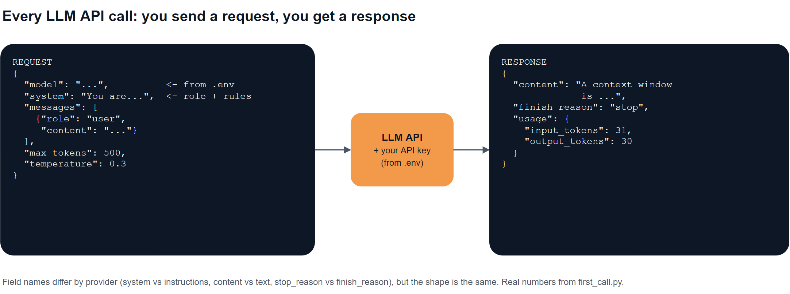
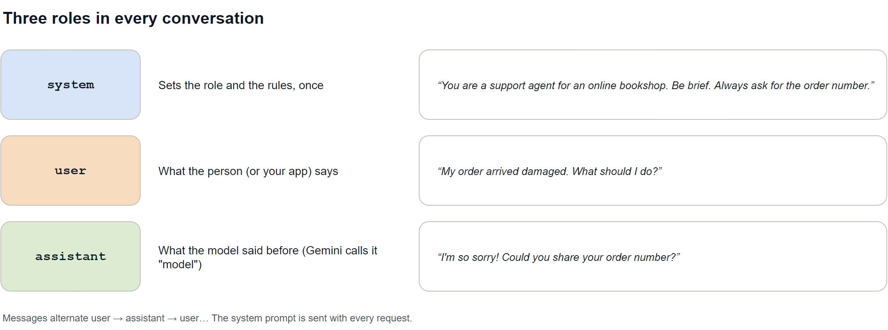
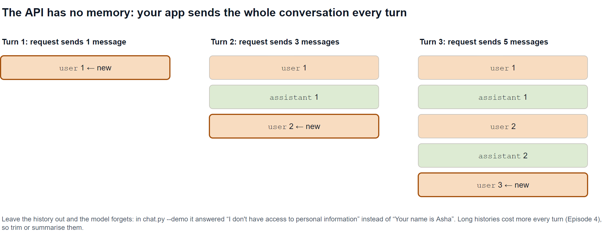
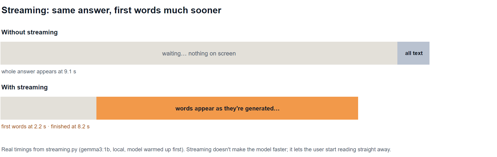

# Episode 07: Calling LLM APIs

The Messages API, system prompts, streaming and multi-turn chat in plain Python, plus what makes a call production-ready.

> **Module 1: LLM Foundations** · Episode 7 of 42 · [Slides](https://amitpnk.github.io/genai-zero-to-production/ep07-calling-llm-apis/)

## What you'll learn

- The **anatomy of an API call**: what you send and what comes back
- The three **roles**: system, user and assistant
- Why the API is **stateless**, and how to build a **multi-turn chat** anyway
- How **streaming** makes apps feel fast
- What turns a demo call into a **production-ready** one

---

## 1. The big idea

> **Every LLM API call is the same shape:** a system prompt, a list of messages, a few settings in; text, a finish reason and token usage out. Learn the shape once and every provider looks familiar.

Every demo in this episode works with **two providers**, chosen with `--provider`:

- `ollama`: the local `gemma3:1b` model (free, offline), the default
- `gemini`: Google Gemini (needs `GEMINI_API_KEY`)

They share one small helper, [`llm.py`](llm.py), so switching providers is one flag. That's [Episode 6](../ep06-model-landscape/)'s *keep it swappable* in practice.

## 2. The anatomy of a call



Real output from [`first_call.py`](first_call.py):

```text
What we send:
{
  "system": "You are a concise assistant. Answer in one sentence.",
  "messages": [
    {"role": "user", "content": "What is a context window?"}
  ]
}

What comes back:
  text:          A context window is a limited-size buffer that a language model uses to consider
                 previous parts of a conversation or text when generating the next response.
  finish reason: stop
  tokens:        31 in, 30 out
```

**Always read all three parts of the response:** the **text**, the **finish reason** ([Episode 5](../ep05-sampling-parameters/)) and the **token usage** ([Episode 4](../ep04-tokens-and-context-windows/)).

## 3. Three roles



| Role | Purpose | Sent |
| --- | --- | --- |
| **system** | Who the model is, the rules, the output format | With every request |
| **user** | What the person (or your app) says | Each turn |
| **assistant** | What the model replied earlier | When you continue a conversation |

### The system prompt changes everything

Same question, *"My order arrived damaged. What should I do?"*, three system prompts. Real output from [`system_prompts.py`](system_prompts.py):

| System prompt | Reply |
| --- | --- |
| **none** | A long, generic guide: *"Okay, this is definitely frustrating! Here's a breakdown… 1. Stay Calm & Gather Information…"* (cut off by the token limit) |
| **support agent**: brief, always ask for the order number | *"Oh no! I'm so sorry to hear that your order arrived damaged. Could you please provide your order number so I can look into this for you?"* |
| **strict JSON** classifier | `{"intent": "damage_received", "urgency": "high"}` |

> Put the **stable rules** (role, tone, format, limits) in the system prompt and the **changing input** in user messages. Module 2 goes deep on writing good prompts.

## 4. The API is stateless

The model **remembers nothing between calls**. To hold a conversation, **your app keeps the history** and sends all of it every turn:



Real output from [`chat.py --demo`](chat.py):

```text
===== WITH history =====
You: Hi! My name is Asha and I'm learning GenAI.
AI:  Hi Asha! That's fantastic – GenAI is a really exciting field...
You: What's my name, and what am I learning?
AI:  Your name is Asha! You're currently learning about Generative AI...

===== WITHOUT history =====
You: What's my name, and what am I learning?
AI:  I understand you're asking about your name! As a large language model,
     I don't have access to personal information...
```

The whole "memory" of a chatbot is a Python list:

```python
history = []
history.append({"role": "user", "content": question})
reply = chat(history, system=SYSTEM)
history.append({"role": "assistant", "content": reply.text})
```

> Long histories get expensive and eventually overflow the context window ([Episode 4](../ep04-tokens-and-context-windows/)). Real apps **trim** old turns or **summarise** them.

## 5. Streaming



Real output from [`streaming.py`](streaming.py):

```text
1) Without streaming: ...9.1 s later, all 95 tokens arrive at once.
2) With streaming:    first words after 2.2 s, finished after 8.2 s
```

Streaming doesn't make the model faster: it sends each piece as it's generated, so the user **starts reading after about 2 seconds instead of 9**. Use it for anything a person waits for.

```python
for piece in stream(messages):
    print(piece, end="", flush=True)
```

## 6. The same call in each provider

The shape is the same everywhere; the field names differ:

| | Anthropic | OpenAI | Gemini | Ollama (OpenAI-compatible) |
| --- | --- | --- | --- | --- |
| **Call** | `messages.create` | `responses.create` | `models.generate_content` | `chat.completions.create` |
| **System prompt** | `system=` | `instructions=` | `system_instruction=` | a `system` message |
| **History** | `messages=[...]` | `input=[...]` | `contents=[...]` | `messages=[...]` |
| **Assistant role name** | `assistant` | `assistant` | **`model`** | `assistant` |
| **Stream** | `messages.stream(...)` | `stream=True` | `generate_content_stream` | `stream=True` |

Full examples for every provider: the [LLM provider cheat sheet](../guides/llm-providers/).

## 7. From demo to production

A demo call is one line. A production call also needs:

| Need | How |
| --- | --- |
| **Secrets** | Keys from the environment or a secret manager, never in code ([Episode 2](../ep02-setup/)) |
| **Timeouts** | Don't let a request hang forever; set a timeout on the client |
| **Retries** | Retry 429 and 5xx with backoff; never retry 401 ([API errors guide](../guides/api-errors/)) |
| **Check the finish reason** | A `length` stop means a cut-off answer ([Episode 5](../ep05-sampling-parameters/)) |
| **Log usage** | Tokens, latency and cost for every call ([tracing guide](../guides/tracing/)) |
| **Stream** | For anything a person waits on |
| **Manage history** | Trim or summarise; keep it server-side per user |
| **Swappable provider** | One wrapper like `llm.py`; model IDs in `.env` ([Episode 6](../ep06-model-landscape/)) |

---

## Run the demos

From the repo root. Every demo takes `--provider ollama` (default) or `--provider gemini`:

```bash
uv run python ep07-calling-llm-apis/first_call.py
uv run python ep07-calling-llm-apis/system_prompts.py
uv run python ep07-calling-llm-apis/streaming.py
uv run python ep07-calling-llm-apis/chat.py --demo        # scripted: with and without history
uv run python ep07-calling-llm-apis/chat.py               # chat yourself (/reset, /exit)

uv run python ep07-calling-llm-apis/chat.py --provider gemini
```

Set your usual provider once in `.env` with `LLM_PROVIDER=ollama` or `LLM_PROVIDER=gemini`. Ollama needs `OLLAMA_MODEL` ([Ollama cheat sheet](../guides/ollama/)); Gemini needs `GEMINI_API_KEY` and `GEMINI_MODEL`.

> The outputs above come from `gemma3:1b` on Ollama. Gemini's replies will be different (and usually better). That's the point of being able to switch.

---

## Interview question (FDE)

> **"Walk me through what happens when your app calls an LLM API, and what you'd add to make it production-ready."**

**A strong answer:**

> "The app builds a request: the model ID from config, a system prompt with the role and rules, the conversation as a list of messages, and settings like max tokens. It authenticates with a key from the environment or a secret manager. The response gives me the text, a finish reason and token usage. The API is stateless, so for a chat I keep the history server-side and trim or summarise it. For production I'd add timeouts, retries with backoff for 429s and 5xx (but not 401s), streaming for anything a user waits on, a check on the finish reason so cut-off answers don't slip through, and logging of tokens, latency and cost on every call. And I'd wrap the provider in one small interface so we can switch models with a config change."

Practise it: say it out loud in your own words before moving on.

## Recap

- Every call: **system prompt + messages + settings in → text + finish reason + usage out**.
- **Roles**: system (rules), user (input), assistant (earlier replies; Gemini calls it `model`).
- The API is **stateless**: your app keeps and resends the history.
- **Streaming** shows the first words in about 2 seconds instead of 9.
- Production calls need **timeouts, retries, finish-reason checks, logging** and a **swappable** wrapper.

## Next up

**Module 2 begins: Episode 08, Prompt anatomy.** Role, context, task, constraints, examples and output format: how to write prompts that work reliably.

---

<sub>Diagram sources: [`diagrams.drawio`](diagrams.drawio), one page per diagram. Open it in draw.io to edit.</sub>
