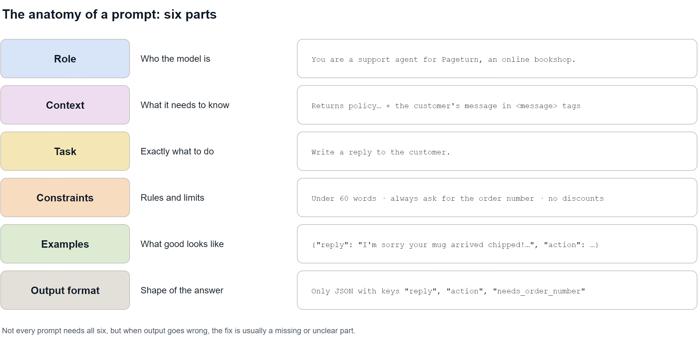
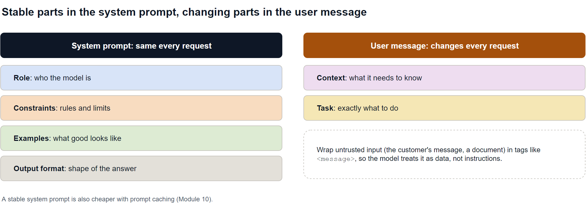
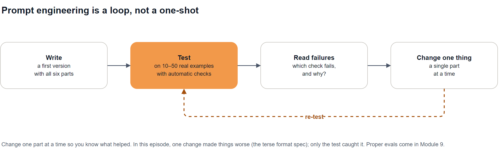

# Episode 08: Prompt Anatomy

Role, context, task, constraints, examples and output format: the six parts of a prompt, and how to test which ones you need.

> **Module 2: Prompt Engineering** · Episode 8 of 42 · [Slides](https://amitpnk.github.io/genai-zero-to-production/ep08-prompt-anatomy/)

## What you'll learn

- The **six parts** of a prompt and what each one fixes
- Why you should **measure** prompts with automatic checks instead of eyeballing one answer
- That **adding instructions can make results worse**, and how to catch it
- How to turn a good prompt into a **reusable template**
- Why a perfect format can still hide a **wrong decision**

---

## 1. The big idea

> **A prompt is a spec, not a wish.** Write it in parts, test it on real examples, and change one part at a time.

You saw in [Episode 7](../ep07-calling-llm-apis/) how much a system prompt changes the output. This episode breaks a prompt into its parts so you know *which* part to fix when something goes wrong.

## 2. The six parts



| Part | Question it answers | Fixes |
| --- | --- | --- |
| **Role** | Who is the model? | Tone, expertise, point of view |
| **Context** | What does it need to know? | Made-up facts; generic answers |
| **Task** | What exactly should it do? | Answering the wrong question |
| **Constraints** | What are the rules and limits? | Too long, off-policy, unsafe |
| **Examples** | What does good look like? | Inconsistent style and format |
| **Output format** | What shape should the answer be? | Answers your code can't parse |

Not every prompt needs all six. But when the output is wrong, the fix is usually a **missing or unclear part**.

## 3. Build it one part at a time, and measure

The demo: a bookshop support bot replying to *"Hi, I ordered 'Dune' last week and it arrived with the cover torn. Can I get a new copy?"*, with a returns policy as context.

[`build_a_prompt.py`](build_a_prompt.py) adds one part at a time and runs **each version 10 times**. Every reply gets four **automatic checks**: under 60 words, asks for the order number, follows the policy (no invented discounts), and valid JSON with an allowed `action`.


Real results (`gemma3:1b`, local):

| Version | ≤ 60 words | Asks order no. | Follows policy | Valid JSON |
| --- | ---: | ---: | ---: | ---: |
| 1 · vague | 8/10 | 10/10 | 10/10 | 0/10 |
| 2 · + role + context | **0/10** | 6/10 | 8/10 | 0/10 |
| 3 · + constraints | 10/10 | 10/10 | 10/10 | 0/10 |
| 4 · + example | 10/10 | 10/10 | 10/10 | 5/10 |
| 5 · + terse format spec | 10/10 | 10/10 | 10/10 | **0/10** |
| 6 · format, rewritten clearly | **10/10** | **10/10** | **10/10** | **10/10** |

**What each step taught us:**

1. **Vague** replies are friendly but unpredictable, and nothing your code can parse.
2. **Role + context** made it *worse* on length: with more to talk about, it wrote 200-word emails with subject lines.
3. **Constraints** ("under 60 words, ask for the order number, no discounts") fixed length and policy straight away.
4. **One example** taught the JSON shape, but only half the time.
5. **A terse format spec** (`"action": "a" | "b"`) made the model *invent new action values*. JSON validity dropped to **0/10**.
6. **The same format, rewritten clearly** ("must be exactly … or …; no other values") gave **10/10 on every check**.

> **Adding instructions can make things worse.** Without automatic checks over several runs, step 5 would have looked like an improvement.

### Why 10 runs, not 1?

Sampling is random ([Episode 5](../ep05-sampling-parameters/)). An early 5-run test of version 4 scored 5/5 valid JSON, and the very next 5-run test scored 2/5. One run, or even five, can fool you. **Judge prompts by pass rates.**

## 4. Where each part goes



- **System prompt:** the stable parts that are the same every request: role, constraints, examples, format.
- **User message:** what changes every request: the context (this customer's message, this document) and the task.
- **Wrap untrusted input in tags** like `<message>…</message>` so the model treats it as data, not instructions. (Episode 11 covers prompt injection.)

## 5. Make it a reusable template

[`prompt_template.py`](prompt_template.py) keeps the six parts as separate fields, so each one can be changed and tested on its own:

```python
@dataclass
class Prompt:
    role: str
    context: str
    task: str
    constraints: str
    examples: str
    output_format: str

    def render(self, **values):
        parts = [self.role, self.context, self.task, self.constraints, self.examples, self.output_format]
        return "\n\n".join(part.format(**values) for part in parts if part)


prompt = SUPPORT_REPLY.render(message=customer_message)
```

Then we test it on **four messages it has never seen**. Real output:

| Customer message | Action chosen | Right? |
| --- | --- | --- |
| "The book I received is 'Emma', but I ordered 'Dune'." | `offer_replacement_or_refund` | ✓ |
| "My order was due on Monday and it still hasn't arrived." | `offer_replacement_or_refund` | ✗ should be `send_tracking` |
| "Two pages in my cookbook are stuck together and torn." | `offer_replacement_or_refund` | ✓ |
| "This is the third time you've messed up. I want a 50% discount NOW." | `offer_replacement_or_refund` | ✗ should be `escalate` |

```text
Valid format: 4/4   Right decision: 2/4
```

**A perfect format can hide a wrong decision.** My first version of this demo only checked the format, and it said 4/4. Once it checked the *action*, it was 2/4.

Why? The prompt's only example used `offer_replacement_or_refund`, so the model **copied it** everywhere. Examples are powerful, sometimes too powerful. **Episode 9** fixes this with varied few-shot examples.

## 6. The iteration loop



1. **Write** a first version with all six parts.
2. **Test** on 10–50 real examples with automatic checks (several runs each).
3. **Read the failures:** which check fails, and why?
4. **Change one part**, then re-test.

Change **one part at a time** so you know what helped. Proper evaluation is Module 9; until then, a few `assert`-style checks go a long way.

---

## Run the demos

From the repo root (`--provider ollama` is the default, or `--provider gemini`):

```bash
uv run python ep08-prompt-anatomy/build_a_prompt.py    # 6 versions × 10 runs; takes a few minutes locally
uv run python ep08-prompt-anatomy/prompt_template.py   # the template on 4 unseen messages
```

> These use the shared helper [`shared/llm.py`](../shared/llm.py) from Episode 7. Your pass rates will vary: that's sampling, and it's exactly why we measure over several runs. A bigger model (Gemini) will usually score higher, but the *lessons* hold.

---

## Interview question (FDE)

> **"A customer's prompt works 80% of the time. How do you debug it?"**

**A strong answer:**

> "First I'd make the 80% measurable: collect the failing cases, build a test set of real examples, and write automatic checks for what 'working' means: format, length, policy, and the actual decision, not just the format. I'd run each prompt version several times, because one run can be luck. Then I'd read the failures and map each one to a prompt part: missing context, an unclear task, a constraint that isn't stated, an example that's biasing the model, or a format spec that's ambiguous. I'd change one part at a time and re-test, keeping whatever raises the pass rate. If the prompt is solid and it still fails, that's when I'd consider structured outputs, a different model, or retrieval for missing knowledge."

Practise it: say it out loud in your own words before moving on.

## Recap

- A prompt has **six parts**: role, context, task, constraints, examples, output format.
- **Measure, don't eyeball:** automatic checks, several runs, pass rates.
- **More instructions can make things worse.** Only tests catch it.
- **Templates** keep parts separate so you can change and test each one.
- **Check the decision, not just the format.** A single example can bias every answer.

## Next up

**Episode 09: Zero-shot, few-shot and chain-of-thought.** When examples help, how to choose them so they don't bias the model, and when to ask it to think step by step.

---

<sub>Diagram sources: [`diagrams.drawio`](diagrams.drawio), one page per diagram. Open it in draw.io to edit.</sub>
